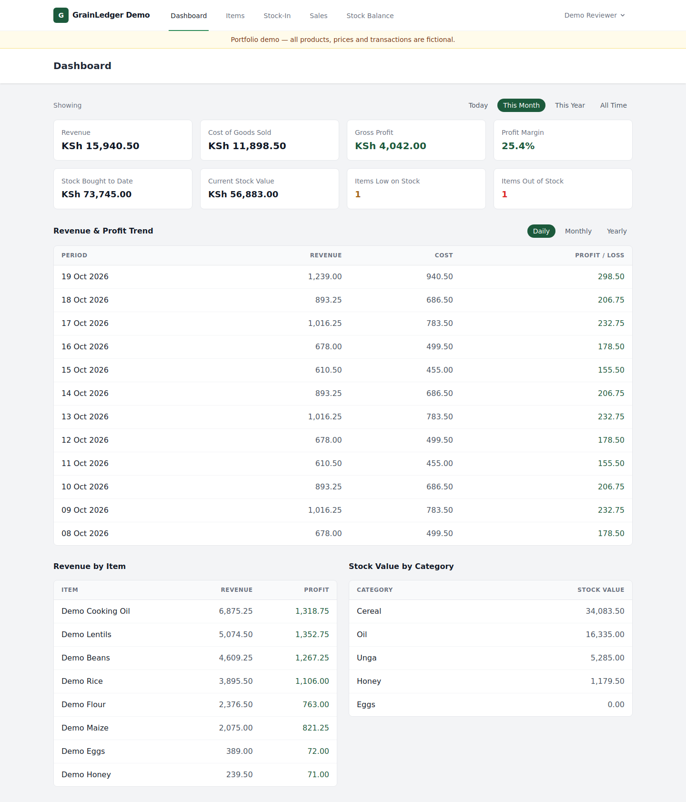
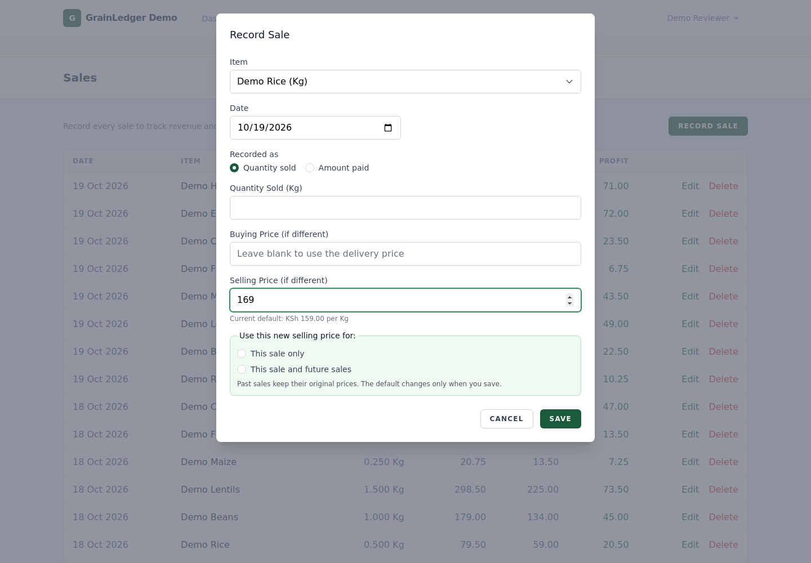

# GrainLedger — Cereal Shop Management

[](https://github.com/Nduta06/KadariStores-Portfolio/actions/workflows/tests.yml)

**A Laravel + Livewire portfolio project by [Nduta06](https://github.com/Nduta06).**

Inventory, sales and gross-profit tracking for a small retail shop, designed for
phone browsers. This showcase uses **fictional data and neutral branding**. It
contains no operational database, production credentials, or client screenshots.
The Git history starts fresh for this portfolio edition.



## What this demonstrates

| Business need | Implementation |
|---|---|
| Track deliveries and remaining inventory | Relational items, deliveries and sales; computed stock balance |
| Handle changing supplier prices | Latest dated delivery updates the buying-price default |
| Handle a discount or permanent selling-price change | Explicit choice: this sale only, or this sale and future sales |
| Keep historical reports stable | Each sale stores its actual unit prices, revenue, cost and gross profit |
| Avoid partial financial writes | Database transactions and item row locks around price/default updates |
| Work from a phone | Responsive Blade/Tailwind layouts with an installable PWA shell |

### A concrete example

An item costs KSh 111 and sells for KSh 159. A later delivery costs KSh 118;
future sales use the appropriate delivery cost, while recorded sales retain
their saved figures. Entering KSh 169 as the selling price asks whether to use
it only for that sale or also update the default for subsequent sales.

These figures are illustrative. **Reported profit is gross profit, not net
profit:** rent, wages and other operating expenses are not deducted.

## Run the demo locally

Requirements: **PHP 8.4+**, Composer 2, Node.js 22+, npm, and PHP's SQLite driver.
MySQL 8 is supported; SQLite is the quickest reviewer setup.

```bash
git clone https://github.com/Nduta06/KadariStores-Portfolio.git
cd KadariStores-Portfolio
composer install
cp .env.example .env
php artisan key:generate
touch database/database.sqlite
php artisan migrate --seed
npm ci
npm run build
php artisan serve
```

Open **http://127.0.0.1:8000**.

| Demo-only login | Value |
|---|---|
| Email | `reviewer@example.test` |
| Password | `PortfolioDemo2026!` |

The demo creates eight fictional products, 14 deliveries and 188 sales spread
over the last 31 days. A banner identifies all figures as fictional. The login
above is intentionally public and is **only for this isolated local demo**.
Never reuse it for an actual business application.

The seeder only runs in local/testing environments and refuses an occupied
database. To reset a **disposable demo database**, run
`php artisan migrate:fresh --seed`. This deletes that database's existing tables;
never point this showcase at an operational database.

For MySQL, create a separate empty demo database, set `DB_CONNECTION=mysql`,
`DB_HOST`, `DB_PORT`, `DB_DATABASE`, `DB_USERNAME` and `DB_PASSWORD` in your local
`.env`, then run `php artisan config:clear` and `php artisan migrate --seed`.
Keep the same `.env` out of Git.

## A five-minute review

1. Sign in and inspect the dashboard, daily/monthly/yearly trends and category totals.
2. Open **Stock Balance**: the seeded example includes low and out-of-stock items.
3. Record a delivery at a different buying price. Reopen the form to see its new default.
4. Record a sale at a different selling price. Choose **This sale only**, then repeat
   with **This sale and future sales** and compare the next sale's default.
5. Inspect an older sale: its stored prices and gross profit remain unchanged.

## Demo screens



[View the mobile stock screen](docs/screenshots/mobile-stock.png).
All screenshots were captured from the fictional data included in this edition.

## Architecture and code to inspect

- [Architecture, data model and pricing decisions](docs/ARCHITECTURE.md)
- [Demo data and publication boundaries](docs/DEMO_DATA.md)
- [Sales component](app/Livewire/Sales/Manager.php): explicit scope validation,
  transactional save and historical-price preservation.
- [Delivery component](app/Livewire/StockIn/Manager.php): chronological defaults
  and transaction boundaries.
- [Sale model](app/Models/Sale.php): quantity/pieces/payment conversion and
  price snapshots.
- [Reporting helpers](app/Support/SalesReport.php): stock balances and time rollups.
- [Regression tests](tests/Feature/Sales/SaleManagementTest.php): business behavior
  and rollback, alongside [delivery tests](tests/Feature/StockIn/StockInManagementTest.php).

Stack: Laravel 13, Livewire 4, Blade, Tailwind CSS, Alpine.js, Vite, MySQL/SQLite,
and PHPUnit. Authentication uses Laravel's session-based scaffolding.

## Validation

```bash
php artisan test
npm run build
```

The workflow in [.github/workflows/tests.yml](.github/workflows/tests.yml) runs
PHP 8.4 checks with SQLite and a disposable MySQL 8 database. The three MySQL
import tests are skipped when the dedicated MySQL test database is unavailable.
Demo seeding has additional tests for fictional data, login and overwrite refusal.
The demo login, dashboard, selling-price prompt and mobile stock screen were also checked in a headless browser.

## Scope and next improvements

- Single-shop, single-owner design; no multi-tenant separation or staff permissions.
- Costs use the latest dated delivery price, not FIFO or weighted-average costing.
- The PWA caches static assets and shows an offline page; saving sales needs a connection.
- Stock can be flagged negative; preventing overselling is a future enhancement.
- Email is logged locally; password-reset email delivery requires configuration.
- No payments, supplier/customer identities, or operating-expense accounting.

This repository demonstrates my implementation and engineering decisions. It
is a standalone showcase, not a deployment of the client's operational system.
