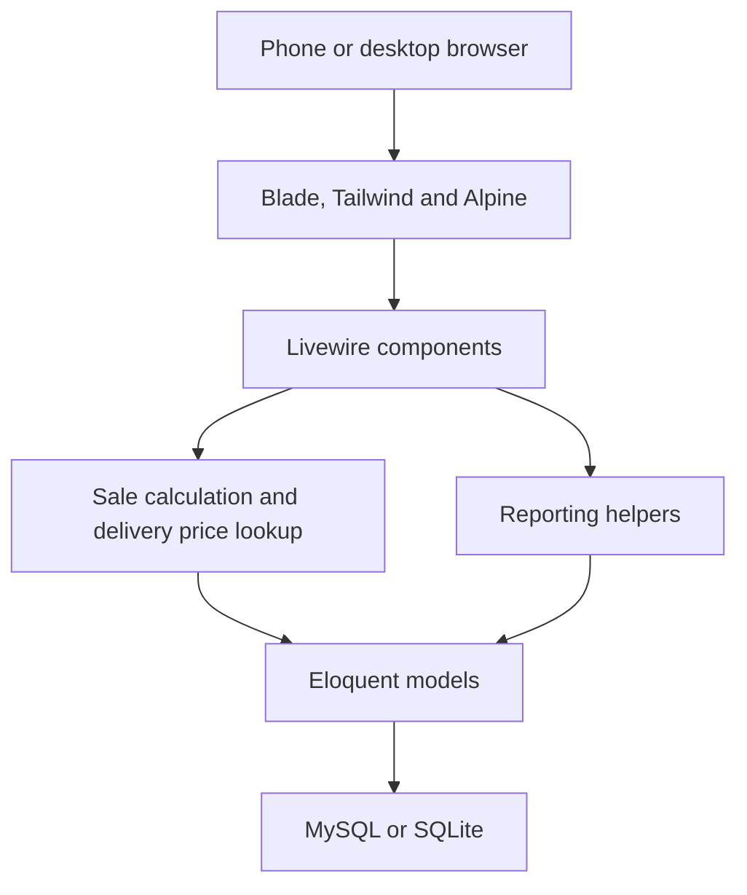
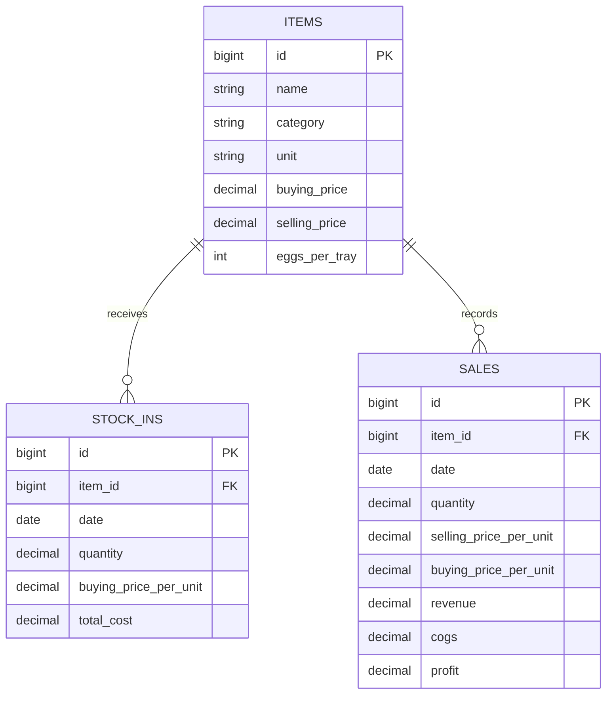

# Architecture and decisions

## Request and data flow

Livewire keeps form state on the server. Components validate inputs and call
Eloquent and calculation helpers. Authentication uses sessions and middleware;
there is no separate REST API or JavaScript application to maintain.

## Data model

The users table serves authentication separately. Sales are not linked to a
staff member; this is a single-owner application. Item foreign keys restrict
deletion when delivery or sales history exists. Quantity columns support three
decimal places, while monetary columns use two.

## Price behavior

Item prices are current defaults. Delivery prices and sale prices are recorded
facts. Updating a default must not rewrite previous sale snapshots.

On delivery save, the component locks affected item rows, writes the delivery,
and chooses the most recent delivery ordered by date then ID to update the
buying-price default. Editing, moving or deleting a delivery recalculates the
remaining latest record. If none remains, the last item default is retained.

On sale save, the component loads and locks the item. A changed selling price
requires `sale` or `future` scope. Both apply that price to the sale; only
`future` also changes the item default. Changing the item or proposed price
clears the decision. Price changes are effective when the form is saved, not
while typing.

The sale cost is looked up from the latest delivery on or before the sale's
date, falling back to the item default when none exists. Saved price snapshots
preserve older results. Editing an existing sale without changing its item or
date retains its recorded cost unless an explicit cost override is provided.

Sale/delivery and default-price writes share a transaction. A failed item
update rolls back the associated record; regression tests exercise that failure.
Row locks protect against concurrent updates on MySQL. SQLite has different
locking behavior, so MySQL has a separate workflow job.

## Calculations and reporting

- Revenue = quantity × sale unit price, or the entered payment in amount mode.
- Cost of goods sold = quantity × recorded buying price.
- Gross profit = revenue − cost of goods sold.
- Loose pieces convert to whole units using the configured pieces-per-unit value.
- Stock balance = delivered quantity − sold quantity.

Reports aggregate stored sale values; they do not recalculate historical
profits from today's prices. Current stock valuation uses the current buying
price. This is deliberately simpler than batch-based FIFO or weighted-average
inventory accounting.

## PWA boundary

The service worker caches static assets. Authenticated pages and form submissions
are not persisted for offline replay. This avoids presenting an offline save as
an accepted financial transaction. Reliable offline sales would require an
explicit local queue, conflict handling and synchronization design.
